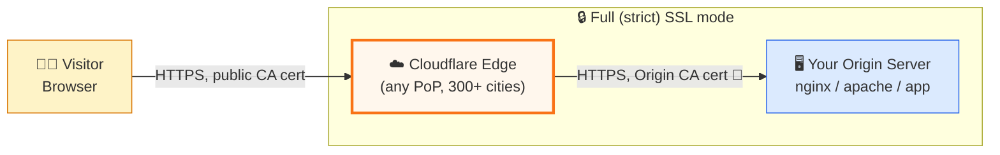
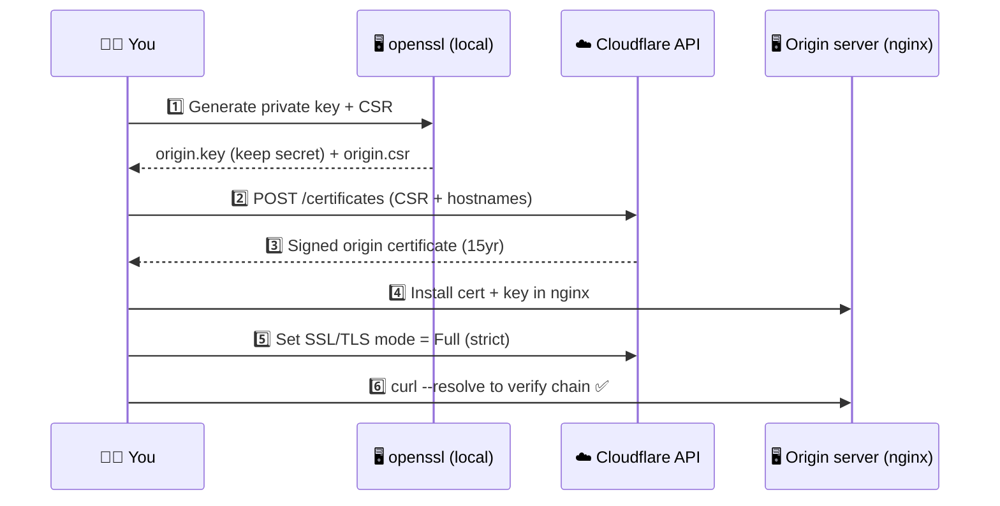
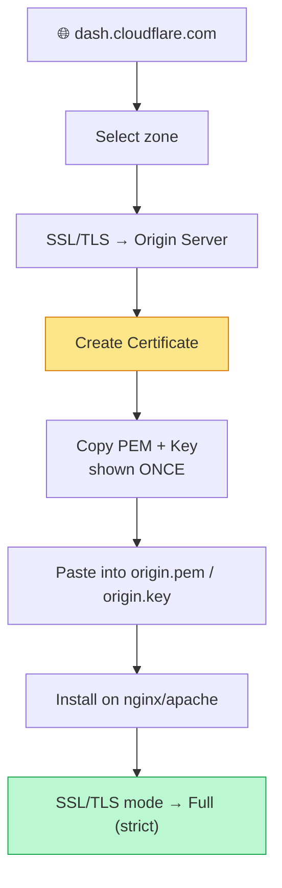
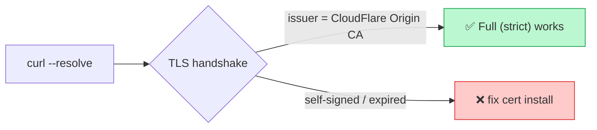

# ☁️🔐 Cloudflare Origin CA Certificate — End-to-End Demo

A hands-on, visual walkthrough of **Cloudflare Origin CA Certificates**: what they are, why they exist, and exactly how to request, install, and verify one — both from the **Cloudflare Dashboard (UI)** and via the **API/CLI** (fully scripted).

> 🎯 Goal: encrypt the hop between Cloudflare's edge and **your own origin server** with a certificate Cloudflare trusts, so you can safely run **Full (strict)** SSL mode.

---

## 🧭 1. Where this fits — the big picture



- **Edge ↔ Visitor**: covered by Cloudflare's universal/edge certificate — nothing to do.
- **Edge ↔ Origin**: *this* is the gap an **Origin CA certificate** closes. Without it, "Full (strict)" mode will reject your origin's self-signed cert.

---

## 🗺️ 2. End-to-end flow in this repo



| Step | Script | What happens |
|---|---|---|
| 1 | [`scripts/01-generate-csr.sh`](scripts/01-generate-csr.sh) | Creates `origin.key` (RSA 2048) + `origin.csr` locally. **Private key never leaves your machine.** |
| 2 | [`scripts/02-request-origin-cert.sh`](scripts/02-request-origin-cert.sh) | Calls Cloudflare's `POST /certificates` Origin CA endpoint with the CSR |
| 3 | — | Cloudflare returns a signed cert valid up to 15 years |
| 4 | [`nginx/origin.conf.example`](nginx/origin.conf.example) | Example server block using the cert + key |
| 5 | Dashboard or API | Switch zone SSL/TLS mode to **Full (strict)** |
| 6 | [`scripts/03-verify.sh`](scripts/03-verify.sh) | Confirms the origin presents a trusted chain |

---

## 🔑 3. Credentials this demo needs

Cloudflare Origin CA certs are issued with a special **Origin CA Key** — *not* your normal API Token. This is intentional (it can only create/revoke origin certs, nothing else on your account).

| Where to get it | Steps |
|---|---|
| 🌐 Cloudflare Dashboard | Log in as `contact@rifaterdemsahin.com` → click your profile (top-right) → **My Profile** → **API Tokens** tab → scroll to **Origin CA Key** → **View** |

Export it locally (never commit this):

```bash
export CF_ORIGIN_CA_KEY="v1.0-xxxxxxxx..."   # from the dashboard above
export CF_ZONE_DOMAIN="example.com"           # your zone/domain on this Cloudflare account
export CF_HOSTNAMES="example.com,*.example.com"
```

> ⚠️ This repo's `.gitignore` excludes `*.key`, `*.csr`, `*.pem`, and `.env` so secrets/keys never get committed.

---

## 🖱️ 4. Method A — Dashboard (click-through, no CLI)

1. Log in to **dash.cloudflare.com** with `contact@rifaterdemsahin.com`
2. Select your domain/zone
3. Left sidebar → **SSL/TLS** → **Origin Server** tab
4. Click **Create Certificate**
5. Choose:
   - Private key type: **RSA (2048)**
   - Hostnames: `example.com, *.example.com`
   - Validity: **15 years** (default)
6. Click **Create** → Cloudflare shows the **Origin Certificate** (PEM) and **Private Key** *once*
7. Copy both into `origin.pem` and `origin.key` on your server (paste into your editor, save)
8. Install on your web server (see §6 below)
9. Back in SSL/TLS → **Overview** → set mode to **Full (strict)**



---

## ⚙️ 5. Method B — API / CLI (fully scripted, reproducible)

```bash
# 1. Generate a private key + CSR (stays local)
./scripts/01-generate-csr.sh

# 2. Send the CSR to Cloudflare, get back a signed cert
./scripts/02-request-origin-cert.sh

# 3. Install on nginx (see nginx/origin.conf.example), then verify
./scripts/03-verify.sh
```

### What `02-request-origin-cert.sh` actually calls

```bash
curl -s https://api.cloudflare.com/client/v4/certificates \
  -H "X-Auth-User-Service-Key: $CF_ORIGIN_CA_KEY" \
  -H "Content-Type: application/json" \
  -d '{
    "hostnames": ["example.com", "*.example.com"],
    "requested_validity": 5475,
    "request_type": "origin-rsa",
    "csr": "-----BEGIN CERTIFICATE REQUEST-----\n..."
  }'
```

Cloudflare responds with the signed certificate under `result.certificate`.

---

## 🧩 6. Installing on the origin (nginx example)

See [`nginx/origin.conf.example`](nginx/origin.conf.example) — key lines:

```nginx
ssl_certificate     /etc/ssl/cloudflare/origin.pem;
ssl_certificate_key /etc/ssl/cloudflare/origin.key;

# Optional but recommended: only accept connections carrying Cloudflare's client cert
# ssl_client_certificate /etc/ssl/cloudflare/authenticated_origin_pull_ca.pem;
# ssl_verify_client optional;
```

Reload: `sudo nginx -t && sudo systemctl reload nginx`

---

## ✅ 7. Verifying it worked

```bash
./scripts/03-verify.sh
# or manually:
curl -v --resolve example.com:443:<ORIGIN_IP> https://example.com/ 2>&1 | grep -E "subject:|issuer:|SSL certificate verify"
```

Expect the issuer to show **CloudFlare Origin SSL Certificate Authority**.



---

## 📁 Repo layout

```
cloudflare-origin-cert-demo/
├── README.md                          ← you are here
├── diagrams/
│   └── architecture.md                ← standalone diagram source
├── scripts/
│   ├── 01-generate-csr.sh
│   ├── 02-request-origin-cert.sh
│   └── 03-verify.sh
├── nginx/
│   └── origin.conf.example
├── .github/workflows/shellcheck.yml   ← lints the scripts on push
├── .env.example
└── .gitignore
```

---

## 🛡️ Security notes

- The **private key** generated in step 1 never leaves your machine and is never sent to Cloudflare — only the CSR (public part) is.
- `CF_ORIGIN_CA_KEY` is scoped **only** to origin certificate create/list/revoke. It cannot touch DNS, WAF, billing, etc. Still treat it as a secret.
- Origin certs are trusted **only by Cloudflare**, not by public browsers — never use them for a server that's reachable directly (bypassing Cloudflare) unless you also lock that down (e.g. Authenticated Origin Pulls + firewall rules allowing only Cloudflare IPs).

## 📚 References

- Cloudflare Docs — [Origin CA certificates](https://developers.cloudflare.com/ssl/origin-configuration/origin-ca/)
- Cloudflare API — [Origin CA Certificates endpoint](https://developers.cloudflare.com/api/resources/origin_ca_certificates/)
