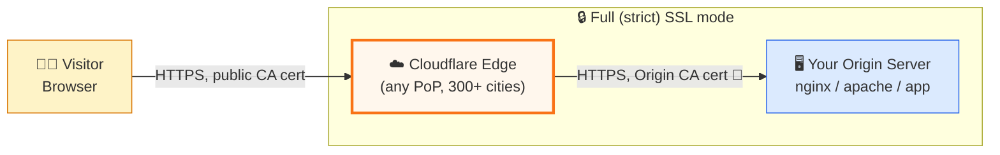
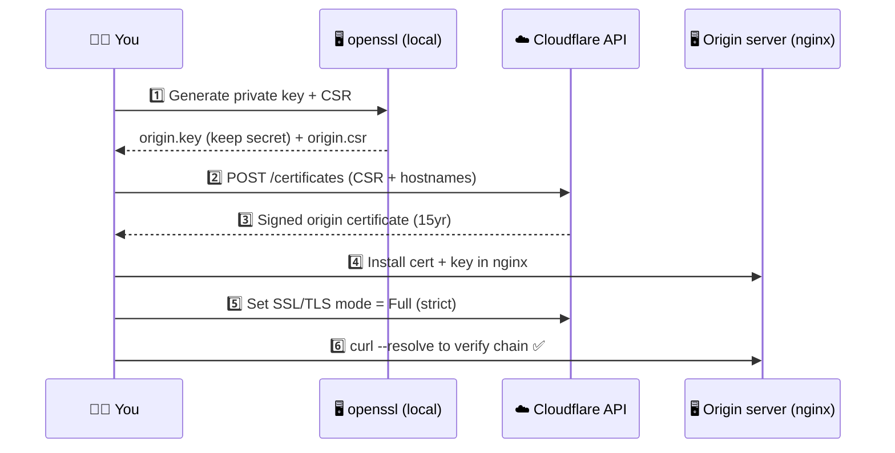
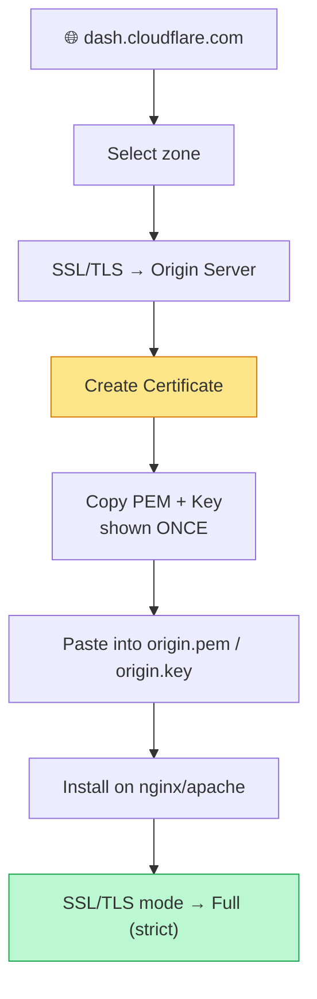
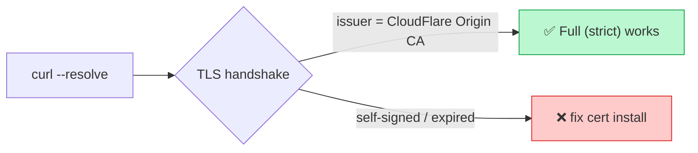

# ☁️🔐 Cloudflare Origin CA Certificate — End-to-End Demo

A hands-on, visual walkthrough of **Cloudflare Origin CA Certificates**: what they are, why they exist, and exactly how to request, install, and verify one — both from the **Cloudflare Dashboard (UI)** and via the **API/CLI** (fully scripted).

> 🎯 Goal: encrypt the hop between Cloudflare's edge and **your own origin server** with a certificate Cloudflare trusts, so you can safely run **Full (strict)** SSL mode.

🌐 **Live interactive demo:** **[cloudflare-origin-cert-demo.fly.dev](https://cloudflare-origin-cert-demo.fly.dev/)** — same walkthrough below, rendered as a single page with clickable Mermaid diagrams (each node links out to the relevant doc, script, or file).

⚡️ **Two Ways to Create & Manage:** See **[`create-certificate.html`](create-certificate.html)** (or [live version](https://cloudflare-origin-cert-demo.fly.dev/create-certificate.html)) — compares the Dashboard UI (still fully available) vs. REST API automation (`Zone > SSL and Certificates > Edit`).

🤔 **New to this?** Read **[`RATIONALE.md`](RATIONALE.md)** (or the [live version](https://cloudflare-origin-cert-demo.fly.dev/rationale.html)) first — a plain-English, no-jargon explanation of *why* this exists, using an office building and an ID badge as the analogy.

---

## 🧭 1. Where this fits — the big picture



- **Edge ↔ Visitor**: covered by Cloudflare's universal/edge certificate — nothing to do.
- **Edge ↔ Origin**: *this* is the gap an **Origin CA certificate** closes. Without it, "Full (strict)" mode will reject your origin's self-signed cert.

---

## 🗺️ 2. End-to-end flow in this repo



| Step | Script | What happens |
|---|---|---|
| 1 | [`scripts/01-generate-csr.sh`](scripts/01-generate-csr.sh) | Creates `origin.key` (RSA 2048) + `origin.csr` locally. **Private key never leaves your machine.** |
| 2 | [`scripts/02-request-origin-cert.sh`](scripts/02-request-origin-cert.sh) | Calls Cloudflare's `POST /certificates` Origin CA endpoint with the CSR |
| 3 | — | Cloudflare returns a signed cert valid up to 15 years |
| 4 | [`nginx/origin.conf.example`](nginx/origin.conf.example) | Example server block using the cert + key |
| 5 | Dashboard or API | Switch zone SSL/TLS mode to **Full (strict)** |
| 6 | [`scripts/03-verify.sh`](scripts/03-verify.sh) | Confirms the origin presents a trusted chain |

---

## 🔑 3. Credentials & Key Generation Process

> ⚠️ **The Origin CA Key (Service Key) is deprecated and was removed on September 30, 2026 — use an API Token with Zone > SSL and Certificates > Edit instead.**

### The Full Picture: Why the Key Generation Changed

#### What the Origin CA Key was
The Origin CA API Key (also called the "Service Key") was a legacy authentication credential used to:
- Create, list, get, and revoke Origin CA certificates via the API
- Enroll Keyless SSL key servers and obtain their authentication certificates
- It was passed via the `X-Auth-User-Service-Key` header.

#### Why it's gone
Per the official deprecation notice, Origin CA Service Keys were removed on **September 30, 2026**. After that date, key server enrollment and certificate refresh using only a Service Key fails. As of November 3, 2026, the key no longer works.

#### What to use now
Create an **API Token** on your Cloudflare dashboard with scoped permissions:

| Scope | Resource | Permission |
|---|---|---|
| **Zone** | **SSL and Certificates** | **Edit** |

This token authenticates all Origin CA certificate API operations (`POST /certificates`, `GET /certificates`, `DELETE /certificates/:id`, etc.) via standard `Authorization: Bearer <TOKEN>` and replaces the Service Key for Keyless SSL enrollment (`api_token` in `gokeyless.yaml` or the `KEYLESS_API_TOKEN` environment variable).

#### If you're migrating Keyless SSL
1. Upgrade `gokeyless` to **1.18.0 or later**.
2. Create an API Token with **Zone > SSL and Certificates > Edit**.
3. Set `api_token` in `/etc/keyless/gokeyless.yaml` (or the `KEYLESS_API_TOKEN` env var).
4. Remove the old `origin_ca_api_key` value.

---

### Getting your API Token

| Where to get it | Steps |
|---|---|
| 🌐 Cloudflare Dashboard | Log in as `contact@rifaterdemsahin.com` → 🔑 **[jump straight to your API Tokens page](https://dash.cloudflare.com/3683d1886e0a3a3152242c84f226ba3f/api-tokens)** → **Create Token** → configure **Zone > SSL and Certificates > Edit** → **Create Token** |

Export it locally (never commit this):

```bash
export CF_API_TOKEN="xxxxxxxx..."             # standard Bearer API token with Zone > SSL and Certificates > Edit
export CF_ZONE_DOMAIN="example.com"           # your zone/domain on this Cloudflare account
export CF_HOSTNAMES="example.com,*.example.com"
```

> ⚠️ This repo's `.gitignore` excludes `*.key`, `*.csr`, `*.pem`, and `.env` so secrets/keys never get committed.

---

## 🖱️ 4. Method A — Dashboard (click-through, no CLI)

1. 🔑 Log in to **[dash.cloudflare.com](https://dash.cloudflare.com/)** with `contact@rifaterdemsahin.com` — or jump straight to **[your API Tokens page](https://dash.cloudflare.com/3683d1886e0a3a3152242c84f226ba3f/api-tokens)** to create an API Token (Zone > SSL and Certificates > Edit)
2. 🌍 Select your domain/zone
3. 🧭 Left sidebar → **SSL/TLS** → **Origin Server** tab
4. Click **Create Certificate**
5. Choose:
   - Private key type: **RSA (2048)**
   - Hostnames: `example.com, *.example.com`
   - Validity: **15 years** (default)
6. Click **Create** → Cloudflare shows the **Origin Certificate** (PEM) and **Private Key** *once*
7. Copy both into `origin.pem` and `origin.key` on your server (paste into your editor, save)
8. Install on your web server (see §6 below)
9. Back in SSL/TLS → **Overview** → set mode to **Full (strict)**



---

## ⚙️ 5. Method B — API / CLI (fully scripted, reproducible)

```bash
# 1. Generate a private key + CSR (stays local)
./scripts/01-generate-csr.sh

# 2. Send the CSR to Cloudflare, get back a signed cert
./scripts/02-request-origin-cert.sh

# 3. Install on nginx (see nginx/origin.conf.example), then verify
./scripts/03-verify.sh
```

### What `02-request-origin-cert.sh` actually calls

```bash
curl -s https://api.cloudflare.com/client/v4/certificates \
  -H "Authorization: Bearer $CF_API_TOKEN" \
  -H "Content-Type: application/json" \
  -d '{
    "hostnames": ["example.com", "*.example.com"],
    "requested_validity": 5475,
    "request_type": "origin-rsa",
    "csr": "-----BEGIN CERTIFICATE REQUEST-----\n..."
  }'
```

Cloudflare responds with the signed certificate under `result.certificate`.

---

## 🧩 6. Installing on the origin (nginx example)

See [`nginx/origin.conf.example`](nginx/origin.conf.example) — key lines:

```nginx
ssl_certificate     /etc/ssl/cloudflare/origin.pem;
ssl_certificate_key /etc/ssl/cloudflare/origin.key;

# Optional but recommended: only accept connections carrying Cloudflare's client cert
# ssl_client_certificate /etc/ssl/cloudflare/authenticated_origin_pull_ca.pem;
# ssl_verify_client optional;
```

Reload: `sudo nginx -t && sudo systemctl reload nginx`

---

## ✅ 7. Verifying it worked

```bash
./scripts/03-verify.sh
# or manually:
curl -v --resolve example.com:443:<ORIGIN_IP> https://example.com/ 2>&1 | grep -E "subject:|issuer:|SSL certificate verify"
```

Expect the issuer to show **CloudFlare Origin SSL Certificate Authority**.



---

## 🛫 8. Worked example — installing the cert on a Fly.io origin

A concrete, runnable stand-in for "install the cert on your real origin server": a small nginx Fly.io **Machine** that terminates TLS itself using the Origin CA cert — just like a VM/VPS would — with Fly only forwarding raw TCP on 443 (no Fly-managed TLS involved).

```mermaid
flowchart LR
    S["📜 origin.pem + origin.key<br/>(from steps 1-2)"] --> B64["🔢 base64"]
    B64 --> SEC["🔒 flyctl secrets set<br/>ORIGIN_CERT_B64 / ORIGIN_KEY_B64"]
    SEC --> DEPLOY["🚀 flyctl deploy<br/>origin-flyio/"]
    DEPLOY --> NGINX["🖥️ nginx terminates TLS<br/>with the Origin CA cert"]
    NGINX --> IP["🌐 Fly dedicated IPv4"]
    IP --> DNS["☁️ Cloudflare DNS A record<br/>🟠 Proxied"]
    DNS --> STRICT["🔐 SSL/TLS mode = Full (strict)"]

    click S "https://github.com/rifaterdemsahin/cloudflare-origin-cert-demo/blob/main/scripts/02-request-origin-cert.sh" "Where the cert comes from" _blank
    click SEC "https://fly.io/docs/apps/secrets/" "Fly.io secrets docs" _blank
    click DEPLOY "https://github.com/rifaterdemsahin/cloudflare-origin-cert-demo/tree/main/origin-flyio" "origin-flyio/ source" _blank
    click NGINX "https://github.com/rifaterdemsahin/cloudflare-origin-cert-demo/blob/main/origin-flyio/nginx.conf" "nginx.conf for the origin" _blank
    click IP "https://fly.io/docs/networking/services/" "Fly.io raw TCP services docs" _blank
    click DNS "https://dash.cloudflare.com/3683d1886e0a3a3152242c84f226ba3f" "Your Cloudflare dashboard" _blank
    click STRICT "https://developers.cloudflare.com/ssl/origin-configuration/ssl-modes/full-strict/" "Full (strict) SSL mode docs" _blank
```



| File | Purpose |
|---|---|
| [`origin-flyio/Dockerfile`](origin-flyio/Dockerfile) | nginx image that decodes the cert/key at boot |
| [`origin-flyio/entrypoint.sh`](origin-flyio/entrypoint.sh) | 🔓 Writes `ORIGIN_CERT_B64` / `ORIGIN_KEY_B64` secrets to `/etc/ssl/cloudflare/` |
| [`origin-flyio/nginx.conf`](origin-flyio/nginx.conf) | Origin server block — TLS terminated with the Origin CA cert |
| [`origin-flyio/fly.origin.toml`](origin-flyio/fly.origin.toml) | 🛫 Raw **TCP passthrough** on 443 (not Fly's auto-TLS) |
| [`scripts/04-install-cert-flyio-origin.sh`](scripts/04-install-cert-flyio-origin.sh) | Prints the exact commands to run — doesn't create or bill anything on its own |

Run it:

```bash
./scripts/04-install-cert-flyio-origin.sh
# then copy/run the printed flyctl + Cloudflare DNS commands
```

> ⚠️ **Cost note:** step 4 of the printed instructions allocates a **dedicated Fly.io IPv4**, which Fly bills at roughly **$2/month**. The script only prints the command — nothing is created or charged until you run it yourself.

---

## 📁 Repo layout

```
cloudflare-origin-cert-demo/
├── README.md                          ← you are here
├── index.html                         ← live interactive version (fly.dev)
├── create-certificate.html            ← ⚡️ Two Ways to Create & Manage (UI vs API)
├── rationale.html                     ← 🤔 plain-English "why" page (live)
├── RATIONALE.md                       ← same, as markdown
├── TODO.md                            ← live progress tracker
├── SOP.md                             ← standard operating procedure
├── diagrams/
│   └── architecture.md                ← standalone diagram source
├── scripts/
│   ├── 01-generate-csr.sh
│   ├── 02-request-origin-cert.sh
│   ├── 03-verify.sh
│   └── 04-install-cert-flyio-origin.sh ← 🛫 worked example (§8)
├── nginx/
│   └── origin.conf.example
├── origin-flyio/                      ← 🛫 Fly.io "origin server" example
│   ├── Dockerfile
│   ├── entrypoint.sh
│   ├── nginx.conf
│   └── fly.origin.toml
├── .github/workflows/shellcheck.yml   ← lints the scripts on push
├── .env.example
└── .gitignore
```

---

## 🛡️ Security notes

- The **private key** generated in step 1 never leaves your machine and is never sent to Cloudflare — only the CSR (public part) is.
- `CF_API_TOKEN` should follow the principle of least privilege, scoped **only** to **Zone > SSL and Certificates > Edit** for the specific zone. The legacy account-level `Origin CA Key` (`X-Auth-User-Service-Key`) was deprecated and removed on September 30, 2026. Still treat tokens as secrets.
- Origin certs are trusted **only by Cloudflare**, not by public browsers — never use them for a server that's reachable directly (bypassing Cloudflare) unless you also lock that down (e.g. Authenticated Origin Pulls + firewall rules allowing only Cloudflare IPs).

## 📚 References

- 🌐 **Live demo** — [cloudflare-origin-cert-demo.fly.dev](https://cloudflare-origin-cert-demo.fly.dev/)
- Cloudflare Docs — [Origin CA certificates](https://developers.cloudflare.com/ssl/origin-configuration/origin-ca/)
- Cloudflare Docs — [Keyless SSL configuration](https://developers.cloudflare.com/ssl/keyless-ssl/configuration/)
- Cloudflare API — [API deprecations & sunset dates](https://developers.cloudflare.com/api/deprecations/)
- Cloudflare API — [Origin CA Certificates endpoint](https://developers.cloudflare.com/api/resources/origin_ca_certificates/)
