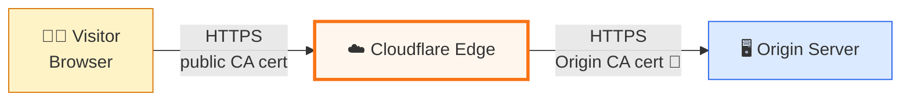
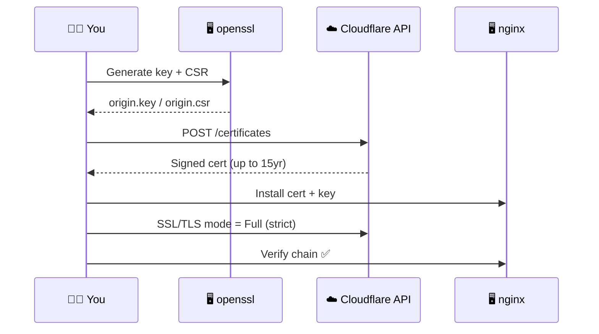
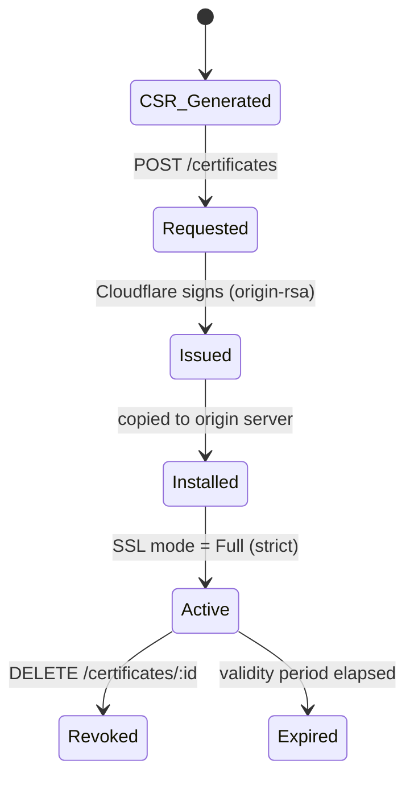

# 🗺️ Architecture diagrams (standalone)

These render on GitHub automatically. Kept separate from the README for reuse in slides/docs.

## Trust boundary

## Request lifecycle

## State machine of a cert

